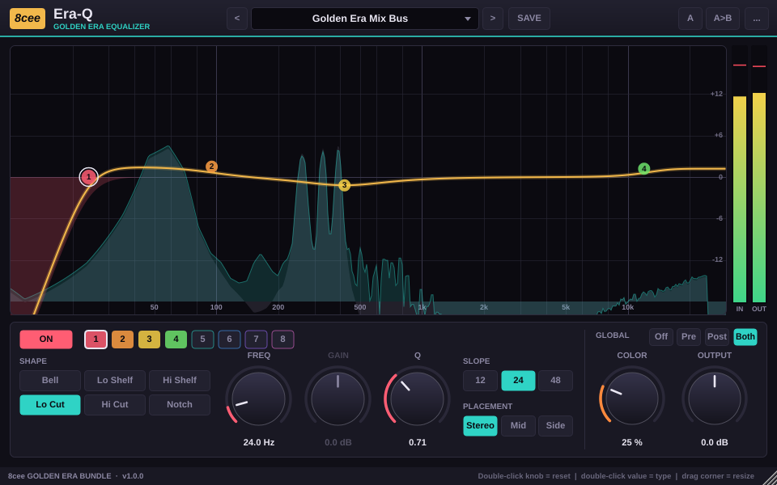
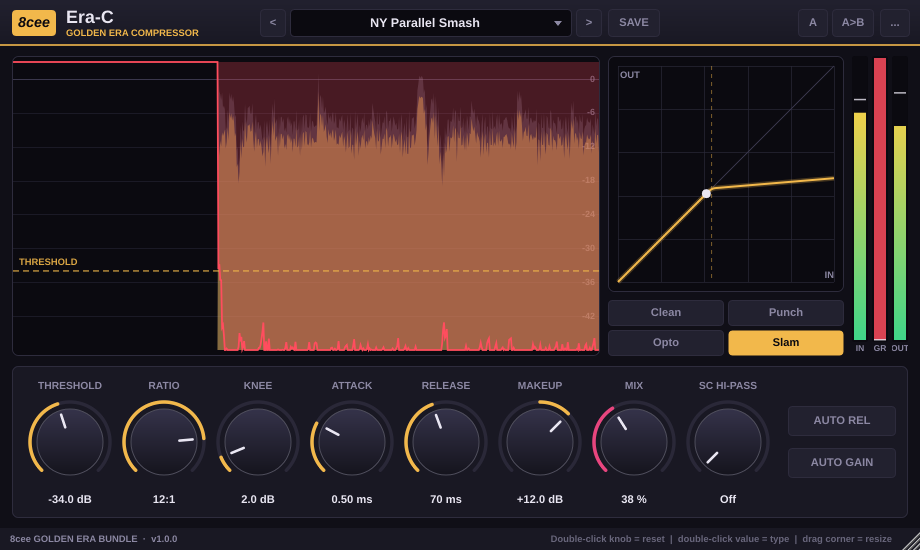
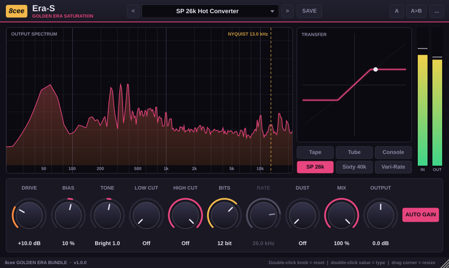
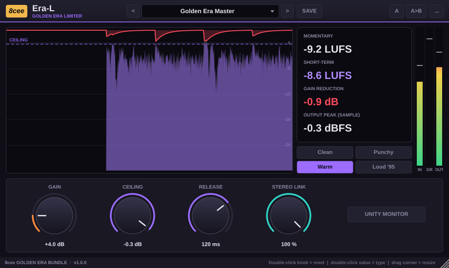

# 8cee Golden Era Bundle

Four mix plug-ins built for **90s New York boom bap, New Jack Swing and R&B**: a modern, resizable vector UI with live spectrum and level displays and a preset browser. Each one ships with factory presets for the sounds of that era.

| Plug-in | What it is | Highlights |
|---|---|---|
| **Era-Q** | 8-band equalizer | Drag nodes on a live pre/post analyzer · Bell, shelf, cut (12/24/48 dB), notch · per-band Stereo / Mid / Side · analog **Color** stage |
| **Era-C** | Compressor | Styles **Clean / Punch / Opto / Slam** · auto release · auto makeup · parallel **Mix** · sidechain high-pass · scrolling GR history + transfer curve |
| **Era-S** | Saturation & sampler grit | **Tape / Tube / Console** saturation plus **SP 26k**, **Sixty 40k** and **Vari-Rate** sampler emulation (bit depth, sample rate, aliasing) · Dust (vinyl crackle) · tone tilt · cuts · auto gain |
| **Era-L** | Limiter | Styles **Clean / Punchy / Warm / Loud '95** · ceiling · stereo link · LUFS read-out · unity-gain monitoring |






Formats: **VST3** (Windows & macOS) and **AU** (macOS). Maker name in your DAW: **8cee**.

## Download & install (no terminal needed)

1. On GitHub open the **Actions** tab → newest green **Build** run → scroll to **Artifacts**.
   (Once a version tag is published, the same files are on the **Releases** page.)
2. **Windows:** download `Golden-Era-Windows`, unzip it and run `8cee-Golden-Era-Bundle-Setup-x.y.z.exe`.
   It installs into `C:\Program Files\Common Files\VST3`. Alternatively copy the four `.vst3` folders from the zip there yourself.
3. **macOS:** download `Golden-Era-macOS`, unzip, then drag the `.vst3` folders into `/Library/Audio/Plug-Ins/VST3` and the `.component` folders into `/Library/Audio/Plug-Ins/Components`.
4. Rescan plug-ins in your DAW (in MPC software: *Preferences → Plugins → Rescan*).

## MPC standalone (VST2, Linux ARM)

All four plug-ins also run **inside MPC OS** on the standalone MPCs (Live, Live II, One, X, Key 61, Force; Gen2 builds too), as native VST2
inserts with their own touchscreen page and Q-Links. They are built on [sd88me/mpc-vst-plugins](https://github.com/sd88me/mpc-vst-plugins)
(its VST2 wrapper and skin tools) from JUCE-free versions of the same DSP in `mpc/`.

- Same sound as the desktop versions: an offline test runs every factory preset through both and compares them (Era-Q, Era-C and
  Era-L match to within -46 dB residual or better; Era-S matches in level and tone, with 2x instead of 4x oversampling).
- All factory presets are in MPC's **PRESET** menu.
- No graphs on MPC (the screen is drawn by MPC from knobs and buttons): Era-Q has a band selector page plus an "All Bands" page.
- Latency: Era-S 0.7 ms, Era-L 3 ms (look-ahead), Era-Q and Era-C none.

**Install:** download **Golden-Era-MPC** from the newest **MPC (VST2 Linux ARM)** run under **Actions** (or from **Releases**).
`-mpc-armv7.zip` is for Gen1 MPCs and the Force, `-mpc-aarch64.zip` for Gen2. Drop the zips into the
[MPC plugin installer app](https://github.com/sd88me/mpc-vst-plugins/releases/latest), which installs them over the network with one MPC restart.
This needs root SSH access to the MPC (a modded unit), as for every plug-in from that project. The skins are in the MPC OS 3.x format.

## Using them

- **Presets:** use the bar at the top. `<` and `>` step through presets, **SAVE** stores your own, **…** opens the user preset folder (`Documents/8cee/Golden Era/<plug-in>/Presets`). A `*` after the name means you changed something.
- **A/B:** **A** switches between two settings, **A>B** copies the current one over.
- **Knobs:** drag to turn, double-click a knob to reset it, double-click a value to type one in.
- **Resize:** drag the bottom-right corner. The plug-in remembers the size.
- **Era-Q display:** double-click to add a band, drag a node to set freq/gain, use the mouse wheel for Q, right-click for shape/slope/placement, double-click a node to remove it. Shift = fine, Alt = gain only.

## Factory presets

**Era-Q:** Dusty Kick Knock · Premier Snare Crack · SP Hat Grit · Drum Bus Thump · Loop Break Carve · Dusty Vinyl Loop · Jazz Sample Make Room · Filtered Bassline Trick · Telephone Chop · 808 Sub Focus · Upright Jazz Bass · New Jack Synth Bass · Gated Snare Smack · Teddy Riley Keys · Swing Beat Bus · Stab Brass Bite · Silky Lead Vocal · Velvet Background Stack · Rap Vocal Presence · Boxy Booth Fix · Golden Era Mix Bus · 90s Tape Master Tilt · Radio Ready Sheen · Mono Low End · Wide Top Air

**Era-C:** NY Parallel Smash · Snare Snap Back · Break Glue · Kick Knock · New Jack Snare Crack · Dusty Loop Pump · Room Mic Crush · Hats Tamer · Steady Bass Line · Sub Leveler · Finger Bass Grip · Boom Bap Rap Vocal · R&B Silk Leveler · Ad-lib Squash · Harmony Stack Glue · Hook Upfront · Crate Loop Squeeze · Keys Smoother · Horn Section Tame · Mix Bus Glue 2:1 · Drum Bus 4:1 Slam · Gentle Master Hold · Radio Mix '94

**Era-S:** SP 26k Grit · SP 26k Hot Converter · SP Filtered Loop · Sixty 40k Swing Warmth · Sixty Drum Bus · Vari 32k Smooth · Vari 22k Lo-Fi Keys · Pitched-Down 15k · 8-Bit Basement · Crushed Hat Sparkle · Cassette Demo '93 · Reel Warm Drums · Dusty Vinyl Loop · Crate Crackle Only · Mixtape Dub · Bus Tape Glue · R&B Vocal Glow · Bass Tube Growl · Rhodes Amp Bark · Warm Mix Bus · Console Kick Push · Snare Board Drive · New Jack Drum Machine Bus · Telephone Radio Hook

**Era-L:** Golden Era Master · Loud '95 Single · R&B Radio Edit · New Jack Club Mix · Mixtape Tape Slam · Vinyl Cut Headroom · Streaming Safe -1 · Boom Bap Knock Master · Drum Bus Peak Catch · Snare Crack Clip · Vocal Peak Catch · 808 / Sub Clip · Sample Loop Flatten · Wide Keys Hold

A suggested chain for a 90s beat: **Era-S** (SP 26k) on the drum loop → **Era-C** (NY Parallel Smash) on the drum bus → **Era-Q** (Golden Era Mix Bus) and **Era-L** (Golden Era Master) on the mix bus.

## Building from source

GitHub Actions builds everything automatically on every push (see `.github/workflows/build.yml`). To build locally you need CMake ≥ 3.22 and a C++17 compiler. JUCE 8 is downloaded automatically:

```
cmake -S . -B build
cmake --build build --config Release
```

`-DERA_BUILD_TESTS=ON` adds offline test runners (`TestEraQ` …) that render a test loop through every factory preset and check for clipping blow-ups, NaNs and Init-preset transparency.

## License

The plug-in code is © 8cee. It is built on [JUCE](https://juce.com), which has its own licensing terms (AGPLv3 or a commercial JUCE licence). Check those before you distribute binaries.
